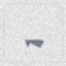

# SIGN NAV PLUS — 共通提出版 R3

## 矢印を読み、確認してから進む

**この作品は、合成した矢印画像と、形の決まったコースを使う学習用シミュレーションです。**
実カメラの映像や実機は使っていません。画像AIの答えを使って、移動ロボットが「進む・別位置で読み直す・停止する」を選びます。

[全19ページの説明資料](presentation/report.pdf) ／ [同じ内容のHTML（ダウンロードしてブラウザで閲覧）](presentation/report.html)

R3は**説明の修正版**です。認識モデル・移動制御・評価条件・元の480走行の成績を変更せず、正解の意味、画像の出所、再確認の設定、動画の見方を明確にしました。元の「旧モデル」は「基本AI」、「改良モデル」は「強化AI」と表記しています。

## 1. まず、何を正解とするのか

3か所の分岐に、左・直進・右のいずれかの矢印を設定します。環境プログラムが方向を決め、その方向の画像を描きます。その**最初に決めた方向が正解**です。

動画で使う実験番号63000の正解は、次のとおりです。

| 標識 | 正解 | 画面上の枝 |
|---|---|---|
| ① | 左 ← | 左側 |
| ② | 右 → | 右側 |
| ③ | 左 ← | 左側 |

地図は下から上へ進む向きで表示します。左右の枝も中央の枝も、先で合流します。そのため、**間違った枝でもゴールには着けます**。

通常の走行試験での成功は、**3つの指示をすべて守り、接触せずにゴールに着くこと**です。ゴール到着だけでは成功としません。

動画の正解ラベルや点線は説明用の重ね描きです。`DecisionPolicy.observe(image)`に渡るのは画像だけで、正解一覧は渡していません。

## 2. 900枚の画像は、どこから来たのか

外部の写真を集めたのではありません。`vision.py`の`render_sign()`が、矢印を描き、角度・大きさ・位置・明るさ・ぼかし・ノイズを変えて生成します。

| 用途 | 枚数 | 各方向の枚数 | 生成seed |
|---|---:|---:|---:|
| 基本AIの学習 | 900 | 300 | 11001 |
| 強化AIの学習 | 4,500 | 1,500 | 51001 |
| 強化AIの途中確認 | 600 | 200 | 52001 |
| 弱い加工の画像テスト | 900 | 300 | 53001 |
| 強い加工の画像テスト | 900 | 300 | 54001 |

**基本AIの学習用900枚と、強い加工のテスト用900枚は別です。** 900回走行したという意味でもありません。

強い加工では、回転を最大±38度、位置ずれを最大±11画素とし、小ささ・ぼかし・ノイズの範囲も変えます。45%の確率で一部分に横長の帯を描きます。矢印の方向は加工前に決めています。加工により、人にも判読しにくい画像が生じます。

強化AIの学習は弱い加工を確率40%、強い加工を確率60%で生成した混合集合です。割合は生成時の確率であり、4,500枚中の内訳が厳密に40:60という指定ではありません。

## 3. 「AIの違い」と「走り方の違い」を分ける

### 画像AIは2種類

- **基本AI**：MLP 576→32→3、弱い加工の900枚で60エポック学習。
- **強化AI**：MLP 576→64→32→3、強弱を混ぜた4,500枚で80エポック学習。

96×96画素の画像を24×24の白黒にし、576個の明るさの数値を入力します。出力は左・直進・右の3スコアです。画像・モデル容量・学習回数などをまとめて変えた比較なので、一つの変更だけの効果ではありません。

### 走り方は4方式

| 記号 | コードのmode | 画像AI | 方向を決めるルール |
|---|---|---|---|
| A | `baseline_once` | 基本AI | 1回の最大スコアの方向へ進む |
| B | `robust_once` | 強化AI | 同上 |
| C | `robust_gate` | 強化AI | 1回でスコア・明暗差の条件を満たせば進み、未達なら停止 |
| D | `active_recheck` | 強化AI | 別位置で再確認。条件を満たした直近2回が一致すれば進む。最大3回でも確認できなければ停止 |

Dの条件は、出力スコア0.95以上、明暗差25以上、直近2回の同方向です。明暗差は画像中央部の明るさの95％点と5％点の差です。これは矢印なし画像への単純な対処で、一般的な未知画像の検出器ではありません。スコア0.95は正解率95％の保証ではありません。

## 4. 別位置で読み直すと、なぜ見やすくなるのか

各分岐の手前に、3つの観測位置があります。ロボットはその位置へ移動し、停止・整列してから画像を受け取ります。

**画像は、位置番号に応じて決めた条件で生成しています。実カメラの移動や遠近投影を計算しているのではありません。**

| 条件 | 位置1 | 位置2・3 | 確認すること |
|---|---|---|---|
| 通常 `normal` | 弱い加工 | 弱い加工 | 普通の条件で指示を守るか |
| 位置変更で改善 `variable` | 強い加工 | 弱い加工 | 見やすい入力を得られる場合の効果 |
| 見えにくさが持続 `persistent` | 強い加工 | 強い加工 | 再確認しても読みにくい場合の限界 |
| ②の矢印なし `covered` | ②は矢印を描かない | ②は同じく描かない | ①を正しく通り、②の前で止まるか |

`covered`の①・③は`variable`と同じ条件です。`persistent`は追加の限界確認ですが、追加時にモデルや判定条件は変えていません。

同じ実験番号・標識・位置・条件なら、方式を変えても同じ画像になります。判断結果を見て画像を変える処理はありません。Dが追加の画像を使うのは、比較する方式の差そのものです。

## 5. 動画の③を、実際の画像で確認する

### 位置1：A・B・Dに同じ画像を渡す



| 方式 | 最初の判定 | 次の動き |
|---|---|---|
| A | 直進（スコア0.889） | 直進する。正解の左とは違う |
| B | 左（スコア0.743） | 左へ進む。この例では正解 |
| D | 左（スコア0.743） | 0.95未満なので追加確認する |

### Dの位置2・3：条件を満たした2回の一致


両方で左と判定し、スコア・明暗差も条件を満たして、左を確定します。

**この1例ではBも正解しています。「再確認したから初めて左と分かった」という例ではありません。** 再確認を含む方式の効果は、同じ強化AIを使うBとDを全30試行で比べて判断します。

動画例は、Aが失敗しDが成功した最初の実験番号63000として選択しています。全体成績は、選択した例だけでなく全番号63000〜63029を集計しています。

## 6. 数値の結果

### 画像テスト：単位は枚

| 画像 | 基本AI | 強化AI |
|---|---:|---:|
| 弱い加工900枚 | 900/900（100.0%） | 900/900（100.0%） |
| 強い加工900枚 | 421/900（46.8%） | 798/900（88.7%） |

### 走行テスト：単位は回

各方式を同じ30実験番号で試しました。

| 方式 | 通常：指示どおり到着 | 位置変更で改善：指示どおり到着 | 見えにくさ持続：指示どおり到着 |
|---|---:|---:|---:|
| A | 30/30 | 2/30 | 2/30 |
| B | 30/30 | 18/30 | 18/30 |
| C | 30/30 | 6/30 | 6/30 |
| D | 30/30 | 30/30 | 6/30 |

「位置変更で改善」と「持続」でCは、23回停止、7回到着し、そのうち1回が指示違反です。Dは持続条件で6回到着・24回停止でした。**停止を成功した到着に加算していません。**

### ②の矢印なし：単位は回

| 方式 | ①を守り、②の手前で停止 | 矢印のない②へ進入 |
|---|---:|---:|
| A | 0/30 | 30/30 |
| B | 0/30 | 30/30 |
| C | 18/30 | 0/30 |
| D | 30/30 | 0/30 |

Cの残り12回は①より前で停止しました。Dのゴール到着は0回です。この停止試験も含め、4条件×30番号×4方式＝480走行です。

## 7. 言える範囲

通常条件の平均は、1回判定が66.9秒、再確認が79.2秒です。約12.3秒の追加時間が必要です。

この実験の前提は、合成画像、既知コース、既知観測位置、正確な自己位置、滑りなしの平面差動二輪運動です。車輪の一次遅れ0.12秒と角加速度上限32 rad/s²を含みます。積分0.01秒、制御0.05秒です。

実カメラの標識検出・実機・未知の道・未知障害物・実画像の汎化性能は検証していません。全480走行の接触0件も、この経路と円対矩形の重なり判定に限る観測です。

再確認の追加画像が見やすい条件では有効でした。追加画像も読みにくい場合は停止が増え、Bより到着数が少なくなりました。この結果を「再確認は常に良い」「実環境でも安全」と一般化しません。

## 8. 実行する

Python 3.13.5で確認しました。GPUやAPIキーは不要です。

```bash
python -m pip install -r requirements-core.txt
python explain_run.py --out results/my_first_run
```

`explain_run.py`は同じ移動処理を1回実行し、結果を日本語で表示します。`results/my_first_run/説明.html`をブラウザで開くと、実際にAIへ渡した画像と判定を確認できます。動画が自動で開く処理ではありません。既存のデモ記録は上書きしません。

```bash
# 既存結果の検証
python verify.py

# 同じ480走行を再実行
python experiments.py

# 単体テスト
python -m pip install -r requirements.txt
pytest -q tests

# 画像の生成・分類結果を再照合
python make_explanation_assets.py
```

`verify.py`は480走行の入力画像と判断を照合し、4つのデモを再走行します。`make_explanation_assets.py`は学習・確認・テストの画像を同じ手順で再生成し、テスト正解数・保存済み予測・画像ハッシュを照合します。

```bash
# 学習からやり直す場合
python train_baseline.py
python train.py
python experiments.py
python verify.py
```

モデルや条件を変更して結果が変わった場合、PDFと動画の数値・説明も見直してください。`report_guard.py`は保存済みの結果が元の説明と違うと、古い説明のまま再生成しないように停止します。

## 9. R3のPDF・動画を再生成する

PDF・動画の作成は、走行自体に必要な処理ではありません。配布済みのPDF・動画はそのまま閲覧できます。

生成にはFFmpeg、日本語フォント、Chromium系ブラウザが別に必要です。フォントファイルは同梱していません。

```bash
python -m pip install -r requirements-media.txt
python -m playwright install chromium
python make_explanation_assets.py
python build_report.py
python make_video.py
# 手元用の8分30秒解説も作る場合
python video_r3.py --kind learn --out deliverables/本人用_ゆっくり解説_R3.mp4
```

LinuxのNoto CJKフォントを標準で参照します。macOSではOSの日本語フォントを探します。必要に応じ`PAI_FONT_REGULAR`と`PAI_FONT_BOLD`へ既存フォントのパスを設定してください。

R3提出動画は1920×1080、20fps、178秒です。日本語の画面説明付き・音声なし。比較走行と停止例の抜粋は2倍速で、停止後の結果は静止表示します。動きは記録された位置・車輪運動に基づきます。正解に合う動きを別途作っているわけではありません。本人用動画は510秒、12fps、走行は1倍速です。

`run_colab.ipynb`はR3の1走行を確認する補助です。Colab上で今回の改訂版を実行した確認はしていません。

## 10. 記録の読み方

- `results/vision_metrics.json`：学習の設定、学習履歴、画像集合とテスト成績。
- `results/test_standard.csv`、`test_stress.csv`：各テスト画像の正解と両AIの予測。
- `results/benchmark/protocol.json`：実験条件、seed、モデルのハッシュ。
- `results/benchmark/trials.json`：480走行の判断・画像ハッシュ・イベント。
- `results/benchmark/summary.json`：集計、時間、回数。
- `results/demo_*/mission.json`：動画例の正解、選んだ方向、各観測の予測。
- `results/demo_*/telemetry.csv`：動画のロボット位置と車輪状態。
- `results/demo_*/camera/`：AIへ実際に渡した合成画像。
- `results/explanation_audit.json`：元の条件を使ったデータ・画像分類・表示内容の照合。
- `results/verification.json`：1,673回の画像判断の再照合とデモ再走行。
- `results/validation_sensitivity.json`：別seedでの閾値感度確認。車輪運動の試験ではなく、480走行にも含まれません。

`camera`は保存フォルダー名です。実カメラで撮影した画像という意味ではありません。

## 参考資料

- scikit-learn, Neural network models (supervised): https://scikit-learn.org/stable/modules/neural_networks_supervised.html
- scikit-learn, Probability calibration: https://scikit-learn.org/stable/modules/calibration.html
- NumPy `load` (`allow_pickle=False`): https://numpy.org/doc/stable/reference/generated/numpy.load.html

使用ライブラリは`THIRD_PARTY_NOTICES.md`を参照してください。


## R3の読み方と点検の意味

通常課題・優秀生選出用に同じPDF、同じ動画、同じコードを使用する版です。

- [ブラウザで読む説明](presentation/reader.html)：図を含む全文、目次付き。
- PDF14ページ：480走行と1,673回の読取りは、数える単位が違います。
- PDF15ページ：全480件の記録点検と、代表4例の再走行を区別します。
- PDF16ページ：テスト画像の再生成と、基本AIの再学習を区別します。
- PDF17ページ：[27件の動作チェック](docs/test_checklist.md)。

このR3作成環境で `python audit_r3.py` を実行し、記録点検・代表4例の再走行・テスト画像の再現・基本AIの再学習一致・27件のテストを確認しました。全480走行を最初から再走行したという意味ではありません。

詳細は `results/verification_r3.json`。利用者のMacやColab、実機での試験を済ませたという意味ではありません。

提出動画は178秒、画面内に日本語説明、走行は2倍速、音声はありません。ゆっくりした本人用解説は別ファイルで、3分以内の提出動画の代わりには使いません。
